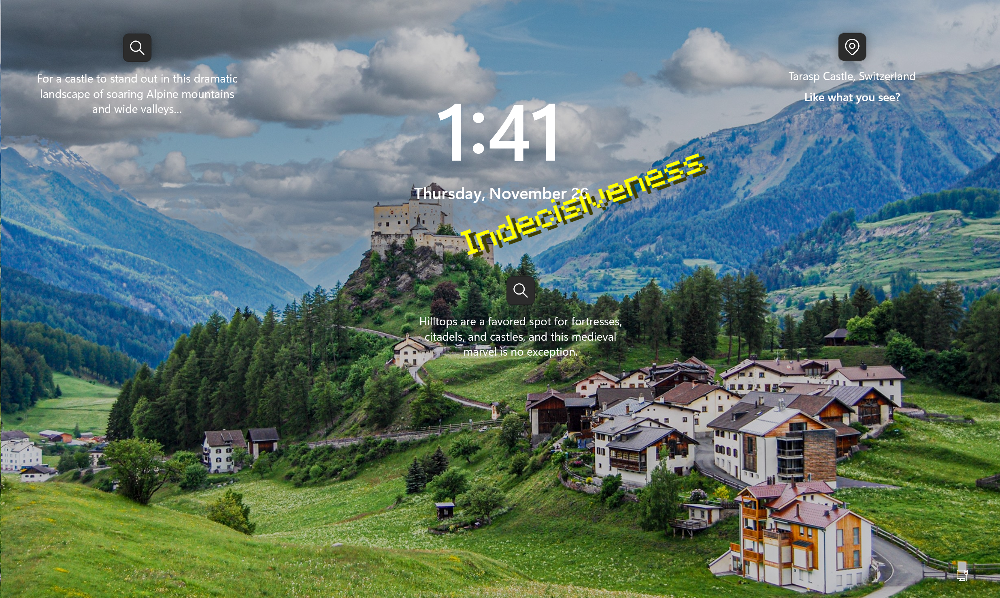

# Lock Screen Splashes

Adds Minecraft-style animated splash texts to the Windows lock screen.

## Features

- Randomized splash texts
- Custom splash text list
- External UTF-8 splash text file
- Custom fonts and fallback fonts
- Customizable text color, shadow, rotation, and position
- Configurable pulse animation
- Automatic splash refresh when locking the screen

The mod preserves the original Windows clock and date.

### External splash file

Since LockApp.exe runs in an AppContainer, it may not
have permission to read arbitrary files.

Ensure that the splash file is accessible to the lock
screen process. Otherwise, the mod will fall back to
the configured splash text list.

The file is checked on startup, when settings are saved, and each time the
lock screen becomes visible. Unchanged files reuse cached splash texts.

## Compatibility

Tested on Windows 11 25H2 (x64).

After installing new fonts, you may need to sign out of Windows
and sign back in for them to become available on the lock screen.

## Credits

Developed by 4tubborn with assistance from ChatGPT.

The implementation is based in part on the following mods:

- [Lock Screen Date and Time Format](https://windhawk.net/mods/lockscreen-datetime-format) by grn15RenS
- [Lock Screen Clock Styler](https://windhawk.net/mods/lock-screen-clock-styler) by ali0zdas

Licensed under GPL-3.0-or-later.